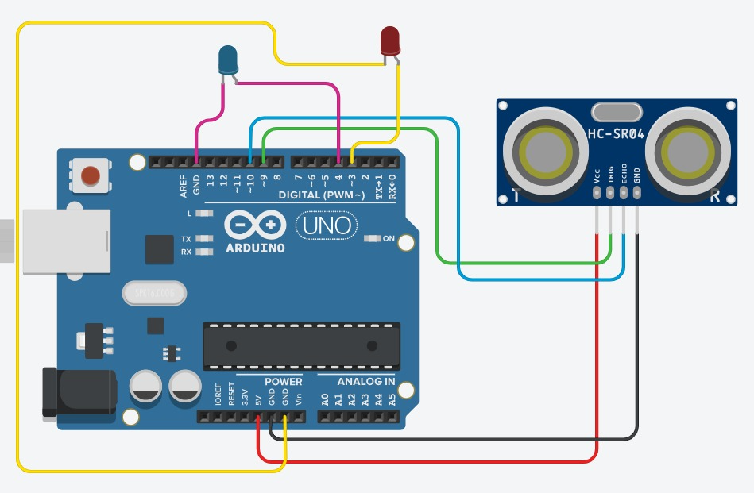
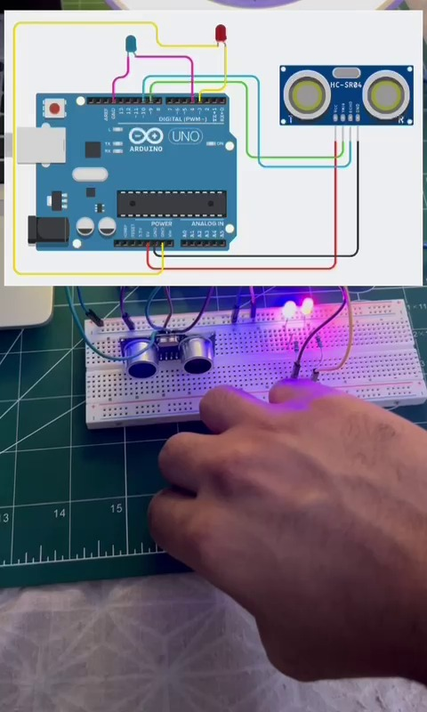
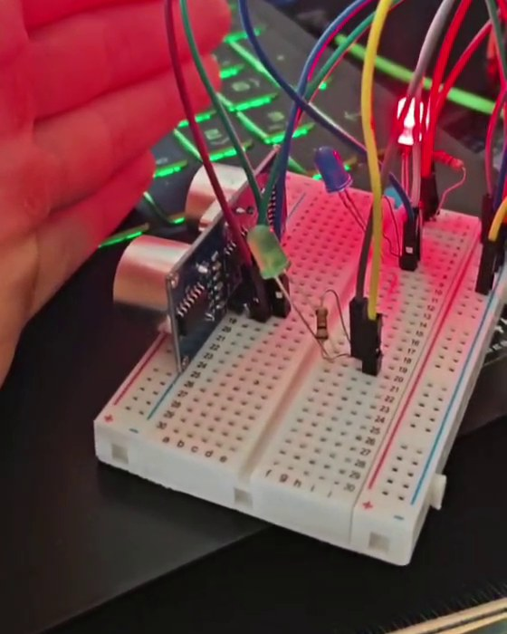
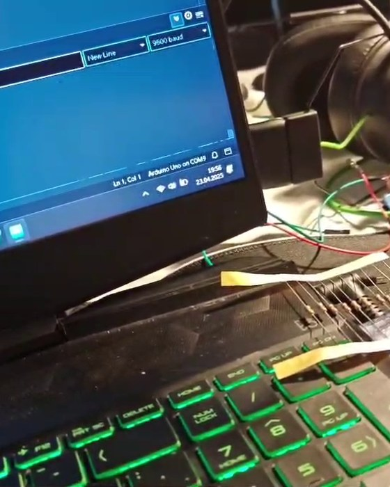
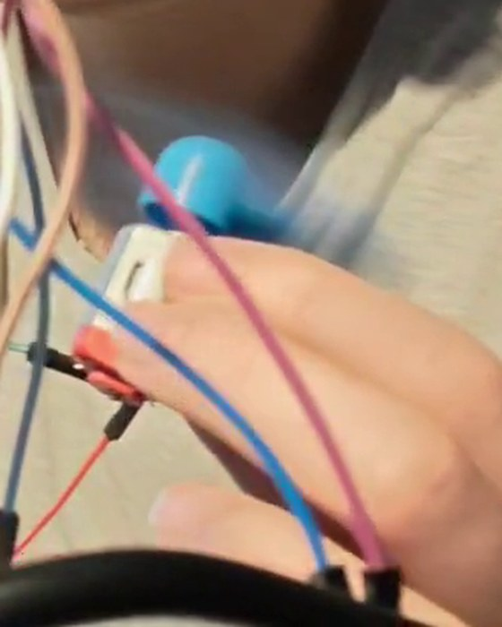
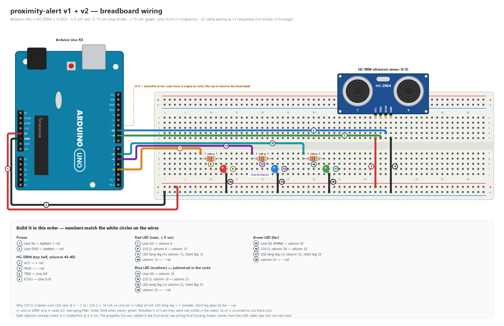
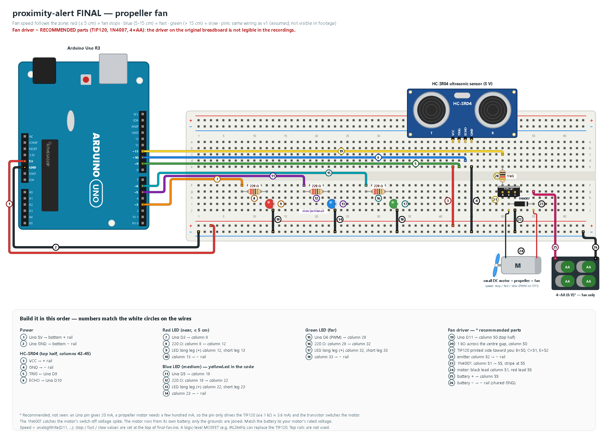

# arduino-proximity-alert

An Arduino Uno build around the HC-SR04 ultrasonic distance sensor: a hand (or anything) in front of the sensor
switches between three distance zones with three LEDs. It grew from a Tinkercad sketch → `v1-simple` →
`v2-advanced` → **final: a propeller fan whose speed follows the zone**. Every wiring diagram is numbered: each
wire carries a white numbered circle, and the list under the drawing tells you what to plug where, in that
order. A Wokwi file lets you run it in the browser without any hardware.

**v1 and v2** (the LEDs; both sketches also switch `motorPin` D11 on at ≤ 5 cm):

| Distance | Green LED | Blue LED (`yellowLed` in code) | Red LED |
|---|---|---|---|
| > 15 cm | **on** (v2: slow "breathing" fade) | off | off |
| 5 – 15 cm | off | **blinks** (v1: fixed 0.2 s · v2: 100–500 ms, faster when closer) | off |
| ≤ 5 cm | off | off | **on** |

**Final build** (propeller fan; the owner's description of the last version):

| Zone | LED | Fan |
|---|---|---|
| far | green | **slow** |
| medium | blue | **fast** |
| near | red | **stops** |

```
proximity-alert/
├── v1-simple/v1-simple.ino        first three-zone version (smoothing: 0.7·old + 0.3·new)
├── v2-advanced/v2-advanced.ino    averaging filter, one function per zone, distance-mapped blink
├── final-fan/final-fan.ino        final fan version, reconstructed 2026 (original sketch not preserved)
├── diagram.json                   Wokwi circuit (works with all three sketches)
└── docs/
    ├── wiring-v1-v2.png / .svg     numbered breadboard diagram: sensor + 3 LEDs
    ├── wiring-final-fan.png / .svg numbered breadboard diagram: + fan with a recommended driver
    ├── draw_wiring.py              generates both diagrams
    └── first-sketch/tinkercad.png  the very first 2-LED Tinkercad circuit
```

### Evolution

1. **Tinkercad sketch** – two LEDs (red D3, blue D4) and the HC-SR04 on D9/D10, LEDs without resistors.
   First breadboard test of the same idea: a hand approaches, the LEDs react.

   

    · clip: [`media/bench_proximity.mp4`](media/bench_proximity.mp4)

2. **v1 – three zones** ([`v1-simple.ino`](proximity-alert/v1-simple/v1-simple.ino)) – green / blinking blue / red,
   a motor pin on D11 and a one-line noise filter: `stableDistance = 0.7·old + 0.3·new`.
   Rebuilt line by line from a screen recording of the original; it compiles to the same
   **3,644 bytes flash / 202 bytes RAM** that the original Arduino IDE reported.

    · clip: [`media/evo_1_simple.mp4`](media/evo_1_simple.mp4)

3. **v2 – averaging + distance-mapped blink** ([`v2-advanced.ino`](proximity-alert/v2-advanced/v2-advanced.ino), 23.04.2025) –
   a moving-average filter, one function per zone (`closeRangeResponse()`, `mediumRangeResponse()`,
   `farRangeResponse()`), blink period `map(average, CLOSE_RANGE, MEDIUM_RANGE, 100, 500)` ms, green LED
   fades in and out in the far zone, `Mesafe: N cm` on the Serial Monitor.
   Lines 58–93 are copied verbatim from the recording (comments translated from Turkish); the rest is completed and marked in the file
   (pin numbers, the two range values and the filter length were not visible).
   Lines 82–93 (`loop()`) are **low confidence**: they were read from one blurred frame.

    · clip: [`media/evo_2_advanced.mp4`](media/evo_2_advanced.mp4)

4. **Final – propeller fan** ([`final-fan.ino`](proximity-alert/final-fan/final-fan.ino)) – a small DC motor with a
   propeller on D11, so the zone is something you can feel as airflow: green = slow, blue = fast, red = the fan stops.
   The final sketch was not kept; `final-fan.ino` is reconstructed (2026) from that description, with the v1 pins
   and zone borders. The motor driver between D11 and the motor is not visible in the recordings, so the diagram
   shows a **recommended** driver (TIP120 + 1N4007 + its own battery).

    · clip: [`media/evo_3_breadboard_fan.mp4`](media/evo_3_breadboard_fan.mp4)

### Wiring

**v1 and v2** – sensor and three LEDs. v2: same wiring as v1 (assumed; not visible in footage):



**Final** – the same board plus the fan. Same wiring as v1 (assumed; not visible in footage — the final sketch was not kept
and the wires in the photos cannot be traced to the board):



| Uno pin | Goes to | Note |
|---|---|---|
| 5V | breadboard + rail | sensor power |
| GND | breadboard − rail | common ground (also the fan battery −) |
| D9 | HC-SR04 TRIG | 10 µs trigger pulse |
| D10 | HC-SR04 ECHO | echo pulse width = distance |
| D3 | 220 Ω → red LED (+) | near |
| D5 | 220 Ω → blue LED (+) | medium (`yellowLed` in the code; the real board uses a blue LED) |
| D6 (PWM) | 220 Ω → green LED (+) | far (`analogWrite`) |
| D11 (PWM) | 1 kΩ → transistor base | fan; final build only (recommended driver, see below) |

v1 and v2 switch the fan pin with `digitalWrite()` (on/off). The final build changes the fan speed, which
needs PWM: `final-fan.ino` uses `analogWrite(motorPin, …)` on D11.

**Fan driver = recommended, not seen.** The driver on the original breadboard is not legible in any recording:
a photo of the final build shows small black three-leg parts (TO-92 size, probably a transistor) whose type cannot
be read. The diagram uses a TIP120, which handles a small motor's current comfortably; a logic-level MOSFET such
as IRLZ44N works the same way.

### Parts (BOM)

| Qty | Part | Note |
|---|---|---|
| 1 | Arduino Uno R3 (or compatible) + USB cable | |
| 1 | HC-SR04 ultrasonic sensor | 5 V module |
| 1 | Breadboard (830 points) + jumper wires | |
| 3 | 5 mm LEDs: red, blue (or yellow), green | |
| 3 | 220 Ω resistor | red-red-brown |
| 1 | Small DC motor + propeller | the fan (final build) |
| 1 | 1 kΩ resistor | recommended driver · brown-black-red |
| 1 | TIP120 NPN Darlington (TO-220) | recommended driver · pins B-C-E with the printed side facing you; a logic-level MOSFET such as IRLZ44N also works |
| 1 | 1N4007 diode | recommended driver · flyback protection |
| 1 | 4×AA battery holder (or a 5 V supply) | recommended fan supply · match your motor's rated voltage |

## Run it in the browser (Wokwi)

1. Open [wokwi.com](https://wokwi.com) → **New project** → **Arduino Uno**.
2. Replace the content of `sketch.ino` with `v1-simple.ino`, `v2-advanced.ino` or `final-fan.ino`.
3. Open the `diagram.json` tab and replace it with [`proximity-alert/diagram.json`](proximity-alert/diagram.json) (one file serves all versions).
4. Press **Start**, click the HC-SR04 in the simulation and drag the distance slider. Watch the Serial Monitor.

Wokwi has no DC motor part, so the fan output (D11) drives an orange LED labelled **fan PWM**: on/off with
v1/v2, dim (slow) or bright (fast) with `final-fan.ino`. The transistor, diode and battery exist only in the real build.

## Flash a real Uno

**Arduino IDE:** open the `.ino` file (the folder name must match the sketch name, it already does) →
*Tools → Board → Arduino Uno* → choose the port → **Upload** → open the Serial Monitor at **9600 baud**.


**arduino-cli:**

```bash
arduino-cli core install arduino:avr
arduino-cli compile -b arduino:avr:uno proximity-alert/v1-simple
arduino-cli upload  -b arduino:avr:uno -p COM3 proximity-alert/v1-simple   # use your port, e.g. /dev/ttyACM0
```

Serial output looks like this ("Mesafe" is Turkish for distance):

```text
Mesafe: 12 cm
```

## Learning notes

- **Why a resistor in front of each LED?** An LED has almost no resistance once it lights up, so without
  one it pulls as much current as the pin can give. 220 Ω keeps it near (5 V − 2 V) / 220 Ω ≈ 14 mA;
  an Uno pin is rated 20 mA (40 mA absolute max). The first Tinkercad sketch ran the LEDs bare; it lit up,
  but it overloads the pin and the LED, so the wiring here has a 220 Ω resistor per LED.
- **Why a transistor for the fan (recommended driver)?** A small propeller motor draws a few hundred mA running and more when it
  starts, far beyond the 20 mA an Uno pin can give. The pin only drives the TIP120's base through
  1 kΩ (≈ 3.6 mA); the TIP120 (a Darlington, gain ~1000) switches the motor current from its own supply.
  A logic-level MOSFET such as IRLZ44N does the same job with less heat.
- **Why the diode?** A motor is a coil. When the transistor switches it off, the coil produces a reverse
  voltage spike. The 1N4007 across the motor (stripe toward +) gives that spike a safe path instead of
  through the transistor.
- **Why a separate fan supply with a shared GND?** Motor current spikes would otherwise make the
  Uno's 5 V dip and the sensor misread. The grounds must be joined so the base signal has a reference.
- **Speed with PWM.** `analogWrite(pin, 0…255)` switches the pin on and off very fast; the motor sees the
  average. That is how the final build runs the fan slow or fast. Small motors often need ~100 or more to start.
- **What `delay()` costs.** In v1 and v2 the blink and the green "breathing" use
  `delay()`, so the sensor is only read between them (about every 0.4 s in the medium zone of v1, about
  once a second in the far zone of v2). The next step is timing with `millis()`, so the loop never stops
  (see [arduino-servo-follow](https://github.com/alpserkanmerkit/arduino-servo-follow)).
- **`pulseIn()` without a timeout.** v1 calls `pulseIn(echoPin, HIGH)`; if no pulse arrives it waits up to
  1 s and returns 0, which v1 would read as "very close". The completed part of v2 and `final-fan.ino` add a
  30 ms timeout and treat "no echo" as far away.

## Diagrams

All wiring images are generated from code with a small drawing kit, [`tools/wiring_kit.py`](tools/wiring_kit.py)
(Uno R3, breadboard, parts, numbered wires, the build-order list). `docs/draw_wiring.py` places the parts
and wires; pin numbers are taken from the sketch.

```bash
python proximity-alert/docs/draw_wiring.py   # -> wiring-v1-v2.svg, wiring-final-fan.svg
python tools/render_png.py                   # every docs/*.svg -> .png (headless Edge or Chrome)
python tools/check_pins.py                   # diagram pins vs. sketch pins + README links; exit 1 on a mismatch
```

Other small Arduino Uno builds by the same author:

- [arduino-servo-follow](https://github.com/alpserkanmerkit/arduino-servo-follow): a servo arm that follows your hand (sketch, not yet tested with a servo)
- [arduino-plant-waterer](https://github.com/alpserkanmerkit/arduino-plant-waterer): "Super Fulffy": a soil-moisture sensor and a servo that waters a plant

## License

[MIT](LICENSE) © 2026 Alp Serkan Merkit
